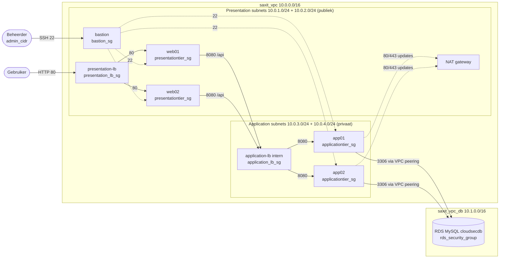

# Week 3: Infrastructure protection (praktische opdrachten)

## Uitgangssituatie (week 1)

In het oorspronkelijke script was de segmentatie zwak:

- Webservers én app servers stonden open voor SSH (22) en ping vanaf `0.0.0.0/0`.
- De app servers accepteerden poort 80 tot en met 9000 vanaf het hele internet en hadden een publiek IP.
- De load balancers deelden de security group met de VM's, dus de LB's hadden ook SSH open staan.
- De application load balancer was internet-facing: de browser riep de API direct aan op poort 8080.
- De database accepteerde 3306 vanaf `0.0.0.0/0`, en de hele app VPC (ook de webservers) had een route naar de database.

## Nieuwe netwerktekening

Belangrijkste ontwerpkeuze: de React frontend roept de API niet meer rechtstreeks aan. nginx op de webservers
stuurt `/api/` door naar de **interne** application load balancer. Daardoor hoeft de application tier helemaal niet
meer vanaf internet bereikbaar te zijn.

## 3.1 North-South segmentatie

North-South is verkeer dat de omgeving in of uit gaat. Wat nog vanaf internet bereikbaar is:

| Van        | Naar               | Poort | Security group       | Waarom                               |
|------------|--------------------|-------|----------------------|--------------------------------------|
| Internet   | presentation-lb    | 80    | `presentation_lb_sg` | De website zelf                      |
| admin_cidr | bastion            | 22    | `bastion_sg`         | Beheer, alleen vanaf jouw IP-adres   |

Uitgaand mogen de VM's alleen naar 80/443 (pakketupdates, Docker images, npm, Maven, GitHub). De app servers doen
dat via de NAT gateway en hebben geen publiek IP meer, dus ze zijn niet van buitenaf te benaderen.

Bestanden: [`infra/security.tf`](../infra/security.tf), [`infra/network.tf`](../infra/network.tf),
[`infra/loadbalancers.tf`](../infra/loadbalancers.tf).

## 3.2 Microsegmentatie (East-West)

East-West is verkeer tussen de onderdelen binnen de omgeving. Iedere tier mag alleen praten met de tier direct
erachter. De regels verwijzen naar security groups in plaats van IP-ranges, dus alleen de juiste resource mag erin,
ook als IP-adressen veranderen.

| Van             | Naar            | Poort | Toegestaan via                                  |
|-----------------|-----------------|-------|-------------------------------------------------|
| presentation-lb | web01/web02     | 80    | `presentationtier_sg` <- `presentation_lb_sg`   |
| web01/web02     | application-lb  | 8080  | `application_lb_sg` <- `presentationtier_sg`    |
| application-lb  | app01/app02     | 8080  | `applicationtier_sg` <- `application_lb_sg`     |
| app01/app02     | RDS             | 3306  | `rds_security_group` <- 10.0.3.0/24, 10.0.4.0/24 |
| bastion         | alle VM's       | 22, ping | `presentationtier_sg`/`applicationtier_sg` <- `bastion_sg` |

Alles wat niet in de tabel staat wordt geblokkeerd, bijvoorbeeld web01 -> web02, web -> app direct (om de LB heen),
web -> database en bastion -> database. Daarnaast zijn de routes beperkt: alleen de application subnets hebben een
route naar de database VPC, en de database VPC routeert alleen terug naar die twee subnets
(zie [`database/rds.tf`](../database/rds.tf) en `aws_route.dbroute_appl_*`).

### Aantonen dat het werkt (screenshots voor je werkstuk)

1. **Applicatie werkt**: open `presentation_lb_url`, voeg een product toe. Screenshot van de Resource map van beide
   load balancers met healthy targets.
2. **Security groups**: screenshot van de inbound en outbound rules van iedere security group in de console.
3. **North-South geblokkeerd** (vanaf je laptop):
   - `ssh ubuntu@<publiek-ip-web01>` -> time-out.
   - `curl http://<publiek-ip-web01>` -> time-out (alleen via de load balancer).
   - `nslookup <application_lb_dns>` geeft alleen private 10.0.x.x adressen: de application-lb is intern.
4. **Bastion werkt**: `ssh -J ubuntu@<bastion> ubuntu@<app01>` lukt.
5. **East-West geblokkeerd** (ingelogd op de bastion of web01):
   - Op web01: `nc -zv -w 3 <prive-ip-app01> 8080` -> time-out (web mag alleen via de LB).
   - Op web01: `curl -s http://<application_lb_dns>:8080/api/products` -> werkt (toegestane route).
   - Op web01: `nc -zv -w 3 <db_endpoint> 3306` -> time-out.
   - Op app01: `nc -zv -w 3 <db_endpoint> 3306` -> *succeeded*.

## 3.3 Immutable infrastructure met GitHub Actions

De workflow [`.github/workflows/infra.yml`](../.github/workflows/infra.yml) doet bij iedere push naar `main` die
`infra/` raakt:

1. `terraform fmt -check` en `terraform validate` (ook op pull requests, zonder AWS-toegang).
2. Controle of de Learner Lab credentials nog geldig zijn (`aws sts get-caller-identity`).
3. `terraform destroy` van de bestaande applicatie-omgeving.
4. `terraform apply` van een volledig nieuwe omgeving.

De database staat in een eigen map en state en wordt dus nooit door de pipeline verwijderd. Niemand hoeft meer met de
hand iets op een server aan te passen: een wijziging betekent een nieuwe commit en een schone uitrol.

### Instellen

In GitHub: **Settings > Secrets and variables > Actions**.

| Type     | Naam                    | Waarde                                                   |
|----------|-------------------------|----------------------------------------------------------|
| Secret   | `AWS_ACCESS_KEY_ID`     | Learner Lab > *AWS Details* > *AWS CLI: Show*            |
| Secret   | `AWS_SECRET_ACCESS_KEY` | idem                                                     |
| Secret   | `AWS_SESSION_TOKEN`     | idem                                                     |
| Secret   | `DB_PASSWORD`           | hetzelfde wachtwoord als bij `database/`                 |
| Variable | `TF_STATE_BUCKET`       | naam van je state bucket                                 |
| Variable | `KEY_NAME`              | naam van je key pair                                     |
| Variable | `ADMIN_CIDR`            | `<ip-van-je-laptop>/32`                                  |

De Learner Lab credentials verlopen na iedere sessie (ongeveer 4 uur). Vul de drie AWS secrets dus opnieuw in
voordat je de pipeline draait. Je kunt de pipeline ook met de hand starten via **Actions > infra > Run workflow**.

### Aantonen

- Doe een kleine wijziging in `infra/` (bijvoorbeeld een extra tag), commit en push.
- Screenshot van de geslaagde run in het tabblad *Actions* met de stappen destroy en apply.
- Screenshot van EC2 met nieuwe instance ID's en starttijden, en de werkende applicatie daarna.
